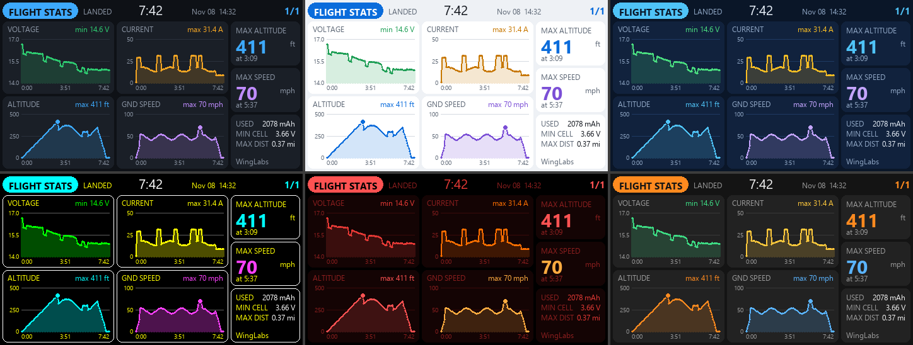

# WL Flight Stats widget — end-of-flight statistics for EdgeTX 2.11 (ELRS/CRSF + INAV)

Fourth WingLabs EdgeTX widget, same style and themes as WL Attitude Ind, WL Avionics and WL Maps.
It records the flight in the background and, after landing (disarm), shows:

- four charts over the flight time: **voltage** (pack, min per sample), **current** (max),
  **altitude** and **ground speed** (max, with a dot on the peak);
- **max altitude** and **max speed** with the flight time at which they were reached;
- used mAh, minimum cell voltage under load and max distance from home;
- flight duration, date and time of landing.

The last **8 flights of each model** are kept on the SD card. The TX16S MK3 (800×480, EdgeTX 2.12+)
build of the same widget is in `widgets_edgetx\800x480px\WLFlightStats`.



## Installation

1. Copy `WIDGETS/WLFlightStats/` (including the `logs/` folder) to the radio SD card:
   `/WIDGETS/WLFlightStats/`. EdgeTX Lua cannot create folders, so `logs/` must exist.
2. On the radio: *Model → Screens* → add a screen with the **Full screen** layout (turn off Top bar,
   Sliders, Trims and Flight mode) and pick the **WL Flight Stats** widget. Small zones get a compact
   layout (max alt, max speed, used mAh, min cell).
3. Fly with any other screen in front: the widget keeps recording in the background. After landing,
   swipe to its screen.
4. Browse older flights: open the widget in full screen (EdgeTX only passes touch and keys to a
   widget in full screen), then turn the roller or tap the left / right half of the screen.

| Option | Values | Default |
|---|---|---|
| Theme | Dark, Light, Navy, Sunlight, Night, Carbon | Dark |
| Units | Imperial (ft, mph, mi), Metric (m, km/h, km) | Imperial |
| Cells | 0 = auto, 1–14 | 0 |
| MinFlight | seconds armed before a flight is saved (bench arming is ignored) | 20 |

Sensors used: `RxBt`, `Curr`, `Capa`, `Alt`, `GSpd`, `GPS`, `FM` (arm state) — run *Discover new
sensors* with the model connected.

## How a flight is recorded

- Recording starts when INAV reports armed and stops at disarm. A flight shorter than *MinFlight* is
  discarded. If the link is lost while armed for 20 s (model switched off, or out of range), the
  flight is saved up to the loss; a new flight needs a disarm first.
- Samples are aggregated into buckets (min voltage, max current/altitude/speed) so sags and peaks
  survive. At 240 buckets, pairs are merged and the bucket length doubles: a 3-minute and a 2-hour
  flight use the same memory. Peaks and their times are tracked at 10 Hz, independent of buckets.
- Buckets without telemetry (short link loss) hold the last values instead of dropping to zero.
- 120 points per series are saved: `logs/<model>.idx` (one summary line per flight) and
  `logs/<model>_<1..8>.txt` (slot files, rotating). `<model>` is the model name, letters and digits only.

## Design principles

Same rules as the other WingLabs widgets, plus:

- The page is static: rebuilt only when the shown flight, theme, units or zone change, and the build
  is split in stages (frame, then one chart per refresh) — worst Lua call ~7.7k instructions on
  480×272 (EdgeTX limit 20k), ~8.3k on 800×480.
- SD access only at start-up (index), when a flight is saved (one slot file + index) and when an
  older flight is selected (one slot file). Nothing large is written or parsed in one call.
- Chart area fill is a single LVGL zig-zag line per chart (no per-pixel objects, no triangle masks).
- After a flight, the four series are resampled one per tick, so landing never causes a CPU spike.

## Layout

```
WIDGETS/WLFlightStats/
  main.lua      options, create/update/refresh/background, navigation, staged build
  telem.lua     CRSF/ELRS sensor discovery and polling (shared with the other widgets)
  recorder.lua  bounded flight recording, peaks, end-of-flight detection
  store.lua     SD storage of the last 8 flights per model
  ui.lua        LVGL page (full and compact layouts)
  themes.lua    the six themes + chart series colors
  logs/         flight files (must exist on the SD card)
tools/sim/      desktop simulator (lupa + Pillow): synthetic flights, storage tests, screenshots
```

Simulator: `pip install -r tools/sim/requirements.txt`, then `python tools/sim/run_sim.py`.
It flies a 7:42 flight, a bench arm, a 25 min flight with a link loss, a model switched off while
armed and enough flights to rotate the 8 slots, reloads from the SD and browses the history.
